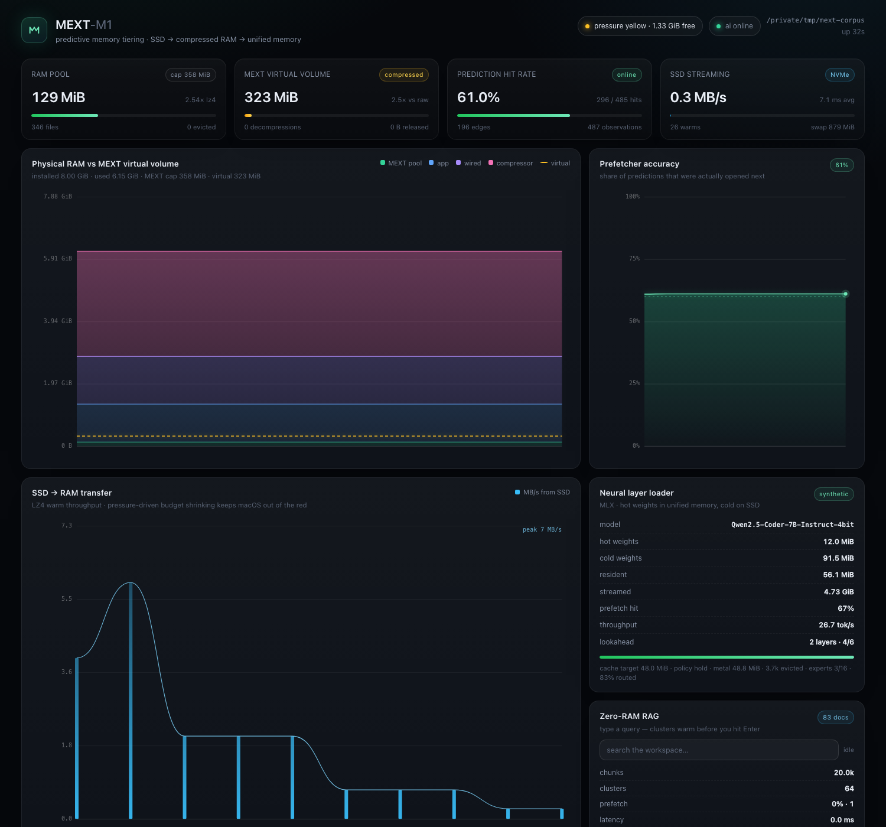

# MEXT-M1

**Предиктивное управление памятью для macOS на Apple Silicon** — userspace-аналог
AMD MEXT. Три модуля работают как один конвейер: SSD → сжатый пул в RAM →
Unified Memory, и всё это под одним CLI и живым дашбордом.

```
FSEvents / mext open ──▶ PredictorEngine (Markov + EMA + время суток)
                                   │ top-K файлов
                 ┌─────────────────┴──────────────────┐
                 ▼                                    ▼
   CompressedMemoryPool (Rust)                 AI engine (Python 3.11 + MLX)
   • LZ4-блоки по 1 MiB                       • горячие веса в unified memory
   • ARC-вытеснение по байтам                 • холодные веса — .npy на SSD,
   • кадр = свой mmap,                          потоковая подгрузка слоёв вперёд
     evict = madvise(MADV_DONTNEED)           • LanceDB IVF_PQ на диске,
   • жёсткий --ram-limit                        прогрев IVF-кластеров по префиксу
                 └─────────────────┬──────────────────┘
                                   ▼
                 JSON-RPC по Unix-сокету + дашборд http://localhost:8765
```



*Скриншот с реального запуска: 8 ГБ M1, `--ram-limit 512M`, воркспейс 581 МиБ.
Пул держит 237 МиБ физической RAM и отдаёт 612 МиБ данных (2.6×), предиктор
попадает в 47.8% предсказаний, MLX-слой стримит холодные веса, LanceDB-индекс
на 20 000 чанков прогрет по префиксу.*

---

## Что реально работает

| Модуль | Технологии | Что проверено |
|---|---|---|
| **Compressed pool** | Rust, `lz4_flex`, `mmap`, `madvise(MADV_DONTNEED)`, ARC, page-arena | жёсткий бюджет по реальным байтам, упаковка мелких кадров в общие страницы, возврат страниц ОС (`released_bytes`), ARC с адаптивным `p`, случайное чтение |
| **PredictorEngine** | цепь Маркова с затуханием, EMA-частота, часовой профиль | online-метрика hit rate, персистентность в `~/.mext/predictor.json` |
| **Neural loader** | MLX, NumPy-стор, один модельный поток, MoE-пейджер | реальный forward на синтетическом трансформере (6 слоёв, 52.5 МиБ холодных весов на SSD), префетч слоёв, адаптивный кэш под давление macOS; **fp16 и 4/8-bit `QuantizedLinear`** через `mx.quantized_matmul` — логиты совпадают с резидентной моделью бит-в-бит |
| **RAG** | LanceDB 0.41, IVF_PQ, mmap-центроиды | индексация 20 000 чанков на диск, прогрев кластеров по префиксу запроса, замер `prefetch_hit` |
| **MoE pager** | MLX router + top-k, `PagedSwitchGLU`, эксперты fp16/4-bit на SSD | реальные `mlx_lm` MoE-чекпоинты (`SwitchGLU` → `PagedSwitchGLU`), численно равно резидентной модели, кэш экспертов ограничен бюджетом, router-guided префетч |
| **Оркестратор** | Rust `tokio` + `axum`, JSON-RPC 2.0 по UDS | `mext start/status/open/predict/warm/bench/index/query/doctor/stop`, профили по воркспейсам |
| **Наблюдаемость** | SSE `/api/stream`, Prometheus `/metrics`, latency-гистограммы | дашборд без polling, 45+ метрик, p50/p95 прогрева и RAG-запросов; готовый Grafana-дашборд |
| **GGUF** | mmap-парсер v1–v3, layer-warmer | чтение метаданных/таблицы тензоров без загрузки весов, группировка по слоям, `MADV_WILLNEED`-прогрев выбранных слоёв для llama.cpp-чекпоинтов |
| **Dev-инструменты** | `make dev/review/ci`, launchd, GitHub Actions | watch-цикл пересборки, один прогон всех проверок, установка пользовательского сервиса, CI на macos-14 |

---

## Требования

- macOS 13+ на Apple Silicon (M1/M2/M3/M4). Используются `madvise`, `vm_stat`,
  FSEvents — x86 не поддерживается.
- Rust 1.75+ (`cargo`).
- Python 3.10–3.13 (MLX требует Apple Silicon).
- 8 ГБ ОЗУ достаточно: рекомендуемый `--ram-limit 2G` оставляет macOS воздух.

## Установка

```bash
cd ultraram
./setup.sh                 # проверки + .venv + mlx/lancedb + release-сборка
./setup.sh --skip-ai       # только Rust-ядро, без MLX/LanceDB
./setup.sh --debug         # debug-сборка
./setup.sh --python /opt/homebrew/bin/python3.12
./setup.sh --with-real-model   # + mlx-lm для локальных fp16/4-bit чекпоинтов
```

Скрипт создаёт `.venv`, ставит `mlx`, `lancedb`, `pyarrow`, `psutil`, `pypdf`,
`pytest`, собирает `core-daemon/target/release/mext` и линкует его в
`~/.local/bin/mext`.

Проверка окружения:

```bash
mext doctor
# ✓ architecture            aarch64 · macos
# ✓ physical RAM            8.00 GiB
# ✓ memory pressure         yellow · free 1.52 GiB · swap 799.1 MiB / 2.00 GiB
# ✓ python                  .../.venv/bin/python
# ✓ python module mlx.core  0.32.4
# ✓ python module lancedb   0.41.0
# ✓ ai-engine               .../ai-engine
# ✓ core socket             ~/.mext/core.sock (daemon running)
```

---

## Быстрый старт

```bash
# 1. Демо на синтетической активности (безопасно для 8 ГБ)
mext start --workspace . --ram-limit 2G --demo

# 2. Открыть дашборд
open http://localhost:8765

# 3. В другом терминале — пожить в системе
mext status
mext open core-daemon/src/core.rs
mext predict core-daemon/src/core.rs
```

Команда из технического задания работает как есть:

```bash
./core-daemon/target/release/mext start \
  --workspace ./my_project \
  --ram-limit 4G \
  --model mlx-community/Qwen2.5-Coder-7B-Instruct-4bit
```

или через make:

```bash
make run RAM=4G WORKSPACE=$PWD          # с демо-активностью
make run-ai RAM=4G                      # с реальным id модели (MLX)
```

### CLI

| Команда | Что делает |
|---|---|
| `mext start --workspace DIR --ram-limit 2G` | демон: монитор + предиктор + пул + AI + дашборд |
| `mext status [--json]` | снимок состояния из демона |
| `mext open FILE` | сообщить предиктору об открытии файла (хук для редактора) |
| `mext predict FILE` | top-K предсказаний с разбивкой score |
| `mext warm DIR [--limit N]` | прогреть датасет/репозиторий в сжатый пул |
| `mext bench DIR --ram-limit 2G` | офлайн-бенчмарк: page cache vs LZ4-пул |
| `mext index DIR` | перестроить LanceDB-индекс (Python-движок) |
| `mext query "..."` | запрос к RAG из терминала |
| `mext doctor` | диагностика окружения |
| `mext profiles [list/show/merge]` | профили предиктора: список, статистика, слияние в один (`--auto` — вес по похожести) |
| `mext gguf inspect/warm/prewarm FILE` | GGUF без загрузки весов, прогрев слоёв, постепенный prewarm |
| `mext stop` | мягко остановить демон (сохраняет предиктор) |
| | `.venv/bin/mext-ai gguf inspect FILE` | то же из Python-движка (без Rust CLI) |

Флаги `start`: `--no-ai`, `--no-neural`, `--no-rag`, `--demo`, `--moe`
(router-guided эксперты в демо-модели), `--trace-open[=backend]`, `--port`,
`--warm-concurrency`, `--lookahead`, `--max-file-mb`, `--python`.

---

## Как это устроено

### 1. `CompressedMemoryPool` — жёсткий бюджет и настоящий `madvise`

* Файл режется на блоки по 1 МиБ, каждый блок сжимается LZ4 независимо — чтение
  4 КиБ не разжимает 40 МиБ.
* Крупный кадр (сжатый файл) живёт в **собственном анонимном `mmap`** с
  выравниванием по странице (16 КиБ на Apple Silicon). Это принципиально:
  `madvise(MADV_DONTNEED)` на памяти из `Vec`/malloc — UB, ядро освободит
  страницы, которыми владеет аллокатор.
* Мелкие кадры (≤ половины страницы) пакуются в **общую арену**
  (`src/arena.rs`): одна мапка на 4 МиБ, страницы со счётчиками ссылок. Шестнадцать
  файлов по 1 КиБ занимают **одну** страницу вместо шестнадцати, а
  `madvise(MADV_DONTNEED)` вызывается, когда умирает последний кадр на странице —
  освобождение остаётся честным (видно по `arena_pages` и `released_bytes`).
* Бюджет считается по **реальным резидентным байтам** (страницы арены + отдельные
  маппинги), а не по «байтам файла», поэтому `--ram-limit 2G` — это честный
  потолок RSS. ARC при этом остаётся политикой выбора жертв.
* Вытеснение — **ARC** (T1/T2 + ghost-списки B1/B2, адаптивный параметр `p`).
  Счётчик `released_bytes` показывает, сколько реально вернули macOS, а
  `overhead_bytes` — остаточную рыхлость страниц.
* Метрики: `resident_bytes` (физика), `compressed_bytes` (payload LZ4),
  `overhead_bytes` (округление до страниц), `logical_bytes` (виртуальный объём),
  `ratio` = logical/compressed, `arc_p_ratio`, `evictions`, `ssd_mbps`.

### 2. `PredictorEngine` — граф переходов, частота и время суток

```
score(next | current) = 0.72 · P(next | current)      # цепь Маркова
                      + 0.18 · P(next в этот час)     # часовой профиль (24 бакета)
                      + 0.10 · freq(next) / max_freq  # EMA-популярность
```

* Рёбра хранят затухающие веса (×0.82 каждые 512 наблюдений), слабые
  обрезаются — граф не растёт бесконечно.
* Каждое предсказание записывается в `pending`; следующий `observe` либо
  засчитывает hit, либо miss. Именно эта величина выводится как
  **Prediction Hit Rate** — без самообмана.
* Состояние сохраняется на диск раз в 20 секунд и при выходе.

### 3. Neural layer loader (MLX)

* **Классификация весов** по имени и размеру (`ai-engine/mext_ai/neural/plan.py`):
  эмбеддинги, все нормы, MoE-роутеры, rotary-таблицы, все bias и тензоры ≤ 64 КиБ
  — *горячие*; attention/MLP-проекции — *холодные*. `lm_head` пинится, потому что
  нужен на каждом токене.
* Холодные веса пишутся **по одному тензору в `.npy`** — стримится конкретная
  проекция, а не целый шард.
* Пока считается слой `i`, фоновый загрузчик читает блоки слоёв `i+1 … i+lookahead`
  с SSD. Промах всегда обслуживается синхронно — корректность не зависит от
  качества предсказания.
* **Все операции MLX идут в одном выделенном потоке.** MLX-массивы привязаны к
  потоку, создавшему их stream; использование из другого потока падает с
  `There is no Stream(gpu, 0) in current thread`. Фоновый загрузчик трогает
  только NumPy, конвертация в `mx.array` — в модельном потоке.
* **Router-guided MoE.** Два пути:
  * синтетическая MoE-модель — `ExpertPager` (`neural/moe.py`), флаг `--moe`;
  * реальные `mlx_lm` MoE — `PagedSwitchGLU` (`neural/switch.py`): `SwitchGLU`
    заменяется целиком, эксперты `SwitchLinear`/`QuantizedSwitchLinear` режутся
    по одному на SSD (`weight`/`scales`/`biases`), роутер остаётся горячим.
    Forward считает только top-k выбранных экспертов теми же ядрами
    (`gather_mm`-эквивалент через `quantized_matmul`), поэтому логиты совпадают
    с резидентной моделью. Для следующего MoE-слоя префетчится union текущего
    routing и частотного EMA — routing липкий между токенами и слоями.
* **Адаптивный кэш** (`mext_ai/memory.py`): headroom = max(320 МиБ, 12% RAM);
  рост не быстрее 1.6× за тик; при `kern.memorystatus_vm_pressure_level` = yellow
  потолок 85% текущего, при red — 55%; `mx.set_cache_limit()` ограничивает кэш
  аллокатора Metal.
* Профилирование: `mx.get_active_memory()/get_peak_memory()` (старое API
  `mx.metal.*` тоже поддерживается) + `psutil` для системной памяти.
* **Квантованные чекпоинты** (4/8-bit) поддерживаются: MLX хранит такой тензор
  как `weight` (uint32, упакованный) + `scales` + `biases`; все три лежат на SSD,
  а проекция собирается тем же ядром `mx.quantized_matmul`, что и у
  `nn.QuantizedLinear`. Тест `tests/test_quantized.py` сравнивает логиты
  стриминговой и резидентной модели крошечной Llama — расхождение 0.0.

### 4. Predictive Zero-RAM RAG (LanceDB)

* Индексируются Markdown/PDF/код: чанки по ~1200 символов с перекрытием,
  эмбеддинг — детерминированный hashing-вектор 384D (без скачивания модели и без
  лишних 500 МиБ в RAM; подменяется любым объектом с `embed(text)`).
* Вектора и текст живут в LanceDB на диске, при >512 чанков строится `IVF_PQ`.
* Центроиды — `centroids.npy` в `mmap_mode="r"`, поэтому поиск ближайших
  кластеров не поднимает весь индекс в память.
* Для каждого кластера лежит `clusters/cN.jsonl` — единица прогрева: один
  последовательный read с SSD.
* `StreamingQueryPrefetcher`: на каждые ~130 мс ввода считается эмбеддинг
  префикса, находятся `nprobe` кластеров и в фоне читаются с SSD. При Enter
  выполняется поиск с `where cluster IN (...)`; `prefetch_hit` = доля
  результатов, чьи кластеры уже были прогреты.

### 4a. GGUF: метаданные и прогрев страниц

`ai-engine/mext_ai/gguf/` — это мост к llama.cpp-чекпоинтам, а не второй рантайм:

* **reader** парсит GGUF v1/v2/v3 через `mmap`, не загружая веса: заголовок,
  полный KV-набор (включая вложенные массивы), выравнивание
  `general.alignment`, таблицу тензоров. Смещения тензоров трактуются по
  спецификации — относительно начала секции данных, абсолютный диапазон
  считается как `data_offset + offset`.
* Размеры считаются по GGML-блокам: F32/F16/BF16, `Q4_0…Q8_0`, `Q2_K…Q8_K`,
  IQ-типы best-effort; неизвестные типы перечисляются, но не ломают разбор.
* Тензоры группируются по `blk.N`, отдельно собираются expert-банки
  (`*_exps`).
* **warmer** прогревает страницы выбранных слоёв: `mmap.madvise(MADV_WILLNEED)`
  плюс по-чанковые касания, возвращает байты/мс/МБ/с. `predict_next()` — это
  секвенциальный lookahead плюс недавно использованные слои (модель читает слои
  по порядку, поэтому предиктор здесь почти оракульный).

```bash
.venv/bin/mext-ai gguf inspect ~/models/qwen2.5-7b-q4_k_m.gguf
.venv/bin/mext-ai gguf warm ~/models/qwen2.5-7b-q4_k_m.gguf --layers 0,1,2 --lookahead 2
```

RPC: `gguf.inspect {path}` и `gguf.warm {path, layers, lookahead}`; HTTP на
дашборде: `GET /api/gguf/inspect?path=…` и `POST /api/gguf/warm
{"path":…,"layers":[…],"lookahead":2}`. Сам инференс GGUF не реализован — веса не
декодируются, но прогрев встроен в запуск llama.cpp:

```bash
bash scripts/llama-with-mext.sh \
  --model ~/models/qwen2.5-coder-7b-q4_k_m.gguf \
  --runner ~/llama.cpp/build/bin/llama-cli --pace-ms 10 \
  -- -m ~/models/qwen2.5-coder-7b-q4_k_m.gguf -p "def fib(n):" -n 128
```

Обёртка поднимает фоновый `gguf prewarm` (постепенно, по слоям) и запускает
раннер; прогретые страницы — общий page cache, без копий и хуков.

### 4b. Профили предиктора

Граф переходов и часовой профиль хранятся **на воркспейс**:
`~/.mext/profiles/<slug>/predictor.json`, где slug — имя каталога плюс короткий
хэш пути. Проекты не портят статистику друг другу; `MEXT_PROFILE=name`
переопределяет профиль (удобно для общих датасетов). Натренированные сессии
можно переносить: `mext profiles list`, `mext profiles show <name>`,
`mext profiles merge --into new-project --weight 0.35` (без `--keep` источники
удаляются, веса и счётчики складываются с коэффициентом). `--auto` выводит вес
каждого источника из Jaccard-похожести множеств файлов (0.2 + 0.6·similarity),
чтобы близкие проекты влияли сильнее.

### 5. Оркестратор и дашборд

Демон поднимает: dashboard, JSON-RPC (`~/.mext/core.sock`, права 0600), FSEvents
монитор, пул, предиктор, Python-движок (`~/.mext/ai.sock`) и цикл надзора
(раз в секунду — пересчёт бюджета под давление, персист предиктора;
раз в 20 с — запись на диск). Python-движок пишет лог в `~/.mext/mext.log`.

**Наблюдаемость.** Дашборд получает данные через SSE (`/api/stream`,
`EventSource` с автоматическим fallback на быстрый polling, если поток
оборвался). Для Grafana есть Prometheus-эндпоинт:

```bash
curl -s localhost:8765/metrics | grep -E 'mext_pool|mext_predictor|mext_neural'
# mext_pool_resident_bytes 2.482944e+08
# mext_pool_arena_pages 12
# mext_predictor_hit_rate 0.478
# mext_neural_expert_hit_rate 0.83
```

Если поток SSE режется прокси или нужен детерминированный скриншот, откройте
дашборд как `http://localhost:8765/?poll=1` — JS переключится на обычный polling.

**Гистограммы latency.** `/metrics` отдаёт полноценные Prometheus-гистограммы
`mext_pool_warm_latency_ms` и `mext_rag_query_latency_ms` (`_bucket/_sum/_count`,
бакеты 0.5 мс … 10 с). В Grafana есть панель p95 через `histogram_quantile`, а
живой дашборд показывает `p95` прогрева прямо в карточке SSD (поле `latency`
в `/api/snapshot`).

**Grafana.** Готовый дашборд лежит в `docs/grafana/mext-dashboard.json`
(16 панелей: пул физика/виртуалка, hit rate, pressure, SSD MB/s, neural
hot/cold/resident, точность префетча слоёв и экспертов, RAG, `released_bytes`,
evictions, RSS). Импорт: Grafana → Dashboards → Import → Upload JSON;
инструкция и scrape-конфиг — `docs/grafana/README.md`.

**Трассировка `open(2)`.** `--trace-open[=auto|eslogger|fs_usage|off]`:
`eslogger` (EndpointSecurity, JSON, узкий фильтр) или классический
`fs_usage`. Оба требуют passwordless sudo; нативный ES-клиент требовал бы
entitlement от Apple, которого у CLI нет — поэтому мы шеллим системную утилиту.
Без sudo остаются FSEvents и хук `mext open`.

---

## Дашборд

`http://localhost:8765` — один HTML-файл, Canvas, без CDN.

1. **Physical RAM vs MEXT virtual volume.** Стековая диаграмма физики
   (MEXT-пул / app / wired / compressor) и пунктир — сколько данных MEXT отдаёт из
   этого объёма. Ось подстраивается под занятую память, установленный объём и
   бюджет написаны в подзаголовке.
2. **Prefetcher accuracy** — online hit rate предсказаний (цель 60%).
3. **SSD → RAM transfer** — МБ/с чтения с NVMe, пики при прогреве слоёв/кластеров.
4. **KPI**: пул (cap/resident/ratio/evictions), виртуальный объём и «сжато»,
   точность, скорость SSD, swap.
5. **Neural loader**: hot/cold, resident, streamed, prefetch %, tok/s, lookahead,
   текущий `action` политики (`grow/hold/shrink`), Metal active.
6. **Zero-RAM RAG**: поле ввода — набирайте запрос, строка справа показывает,
   сколько кластеров прогреть удалось и за сколько мс; Enter — реальный поиск с
   пометкой `prefetch hit/miss`.
7. **Activity** (FSEvents/предиктор/прогрев/бюджет) и **Pool contents**.

Дашборд только читает: он не влияет на решения демона.

---

## Бенчмарк: RAM «до» и «после»

Методика (`mext bench`, `core-daemon/src/bench.rs`):

* **baseline** — то, как это делает ОС: файл нужного объёма должен целиком лежать
  в page cache. Это *лучший* случай по латентности и *худший* по RAM.
* **mext** — те же файлы живут в LZ4-пуле; чтение включает распаковку.
* Считаются: время, МБ/с, RAM для удержания набора, коэффициент сжатия,
  вытеснения; `ps`/`rss` процесса — отдельно.

Реальный прогон на этой машине (M1, 8 ГБ, macOS 27.2, 200 файлов датасета):

```
  MEXT-M1 benchmark · 200 files · working set 290.2 MiB
  ──────────────────────────────────────────────────────────────────────
                                     baseline (page cache)    mext (LZ4 pool)
  wall time                                  222.6 ms           378.3 ms
  throughput                                4103 MB/s          2414 MB/s
  RAM to keep set resident                  290.2 MiB          112.5 MiB
  ──────────────────────────────────────────────────────────────────────
  compression ratio 2.60× · RAM saved 177.7 MiB (61%) · evictions 0
  warm-up pass: 437.5 ms · mext/baseline speed 0.59×
  note: baseline — это page cache, лучший случай для несжатой RAM.
        MEXT платит ~1.7× латентности за 61% меньше резидентной RAM.
```

Воспроизвести:

```bash
make bench                      # или
bash scripts/bench.sh . 2G
```

`scripts/bench.sh` делает две фазы: офлайн-бенчмарк и живой прогон (демон,
60 файлов через `mext open`, затем снижение cap до 256M — видно, как
`released` растёт, потому что страницы реально уходят в ОС).

Живая проверка «до/после» на своём проекте:

```bash
mext start --workspace ~/code/proj --ram-limit 2G &
mext warm ~/code/proj --limit 400
mext status          # resident vs virtual vs ratio
ps -o rss= -p $(pgrep -f "mext start")
sysctl -n kern.memorystatus_vm_pressure_level     # 1 green / 2 yellow / 4 red
```

Что важно понимать: MEXT не «обходит» Unified Memory. Он меняет расклад —
**меньше физической RAM на тот же объём данных, ценой CPU на LZ4 и латентности
чтения.** Для 8 ГБ это разница между «проект не влезает» и «влезает».

---

## Ускорение разработки

```bash
make dev                 # watch: пересборка + рестарт debug-демона на каждую правку
make dev-once            # только debug-сборка
make review              # release build + cargo test + pytest + node --check + selftest
make ci                  # те же проверки, что в GitHub Actions, без демона
make service-install     # launchd user service (release bin, авто-рестарт, лог)
make service-status      # launchctl print
make service-uninstall
bash scripts/install-service.sh --dry-run   # посмотреть plist, ничего не записывая
```

`scripts/dev.sh` использует `cargo-watch`, если он установлен, иначе — debounced
mtime-цикл; при Ctrl-C демон останавливается и сокет не остаётся висеть. Сервис
ставится в `~/Library/LaunchAgents/com.mext.daemon.plist` с `KeepAlive` и логом
`$MEXT_HOME/service.log`.

CI (`.github/workflows/ci.yml`) гоняет на `macos-14`: `cargo fmt --check`,
`cargo test`, `pytest`, `node --check`, `mext-ai selftest` (если MLX доступен),
с кэшем cargo/pip и загрузкой `~/.mext/mext.log` при падении.

## Тесты

```bash
make test          # всё сразу
make test-rust     # 65 тестов
make test-py       # 55 тестов
make selftest      # MLX forward + LanceDB + префетч
make e2e           # живой демон: CLI + HTTP (без AI, быстро)
make e2e-ai        # то же + MLX и LanceDB
```

Покрыто:

* **Rust (65):** парсинг размеров/swap, `vm_stat`, `madvise` на своих маппингах,
  ARC (вытеснение, ghost-адаптация `p`, update/shrink/drain), LZ4-пул (hit/miss,
  случайное чтение, жёсткий бюджет, `released_bytes > 0`, пропуск больших файлов),
  предиктор (Марков, время суток, hit rate, сохранение), FSEvents-наблюдатель,
  JSON-RPC по UDS, снимок ядра, IPC-команды, **гистограммы latency**
  (бакеты/кумулятивность/NaN), **слияние профилей** (веса, счётчики, границы),
  листинг профилей с пропуском битых файлов, квантили гистограмм и
  Jaccard-похожесть профилей.
* **Python (55):** JSON-RPC сервер/клиент (ошибки, конкурентные клиенты), контроллер
  памяти (рост/сжатие/min), классификация весов, cold store (бюджет, pin,
  фоновый префетч, индекс), MLX-раннер (генерация, рост prefetch-hit, тюнинг кэша),
  LanceDB (индексация, инкрементальность, поиск, кластеры, `prefetch_hit`), движок
  целиком через RPC, **квантованный стриминг** (эквивалентность
  `nn.QuantizedLinear`, bias, обёртка крошечной 4-bit Llama с `maxdiff = 0.0`),
  **арена** (упаковка, refcount-освобождение страниц), **MoE** (эквивалентность
  плотному эталону, ограничение кэша экспертов, router-guided префетч),
  **paged SwitchGLU** (fp16 и 4-bit эксперты, tiny Mixtral end-to-end,
  router-guided lookahead между слоями), **GGUF** (синтетический файл v3:
  метаданные, выравнивание, размеры Q4_0, слои, эксперты, warmer, gradual
  prewarm, CLI/RPC, отказ на мусоре).
* **Grafana-модель (1):** JSON парсится, у каждой панели есть Prometheus-запрос
  с метрикой `mext_*`, покрыты все три слоя и pressure.
* **E2E (`make e2e` / `make e2e-ai`):** поднимает настоящий демон на временном
  воркспейсе и проверяет CLI (`open/predict/warm/status/stop`) и HTTP
  (`health/snapshot/observe/predict/prefetch/budget/rag/neural/stream/metrics`) —
  включая жёсткость бюджета, деградацию AI-эндпоинтов без движка, SSE-кадр,
  Prometheus-экспозицию (включая `_bucket/_sum/_count`), MoE-метрики,
  отсутствие паник, сохранение `predictor.json` и листинг профилей после выхода.
* **Синтаксис JS/HTML:** `node --check dashboard/app.js`.

Проверка вручную, без pytest:

```bash
.venv/bin/python -m compileall -q ai-engine/mext_ai
python3 -m mext_ai selftest      # или .venv/bin/mext-ai selftest
```

---

## Реальные модели (и честные ограничения)

* По умолчанию Neural loader поднимает **синтетический трансформер** (6 слоёв,
  384 dim, 52.5 МиБ холодных весов). Это не заглушка: реальный forward, реальные
  `.npy` на SSD, реальный префетч, реальные счётчики Metal. Так пайплайн можно
  проверить на любом Mac без скачивания 4 ГиБ.
* **Локальный чекпоинт MLX — fp16/bf16 или 4/8-bit** — подхватывается
  автоматически: каждая холодная `nn.Linear` / `nn.QuantizedLinear` заменяется на
  `StreamedLinear` / `StreamedQuantizedLinear` (`ai-engine/mext_ai/neural/wrap.py`).
  Для 4-bit на SSD лежат `weight`+`scales`+`biases`, а проекция считается
  `mx.quantized_matmul(..., group_size, bits)` — тем же ядром, что у резидента,
  поэтому численно результат идентичен.
* Скачивание не автоматическое: движок оборачивает только существующую
  директорию. Полный путь:

  ```bash
  .venv/bin/pip install -e 'ai-engine[real-model]'      # mlx-lm
  huggingface-cli download mlx-community/Qwen2.5-Coder-7B-Instruct-4bit \
      --local-dir ~/models/qwen25-coder-7b-4bit
  mext start --workspace ~/code/project --ram-limit 3G \
      --model ~/models/qwen25-coder-7b-4bit
  ```

  В дашборде `Neural layer loader` покажет `mode: mlx_lm` (вместо `synthetic`),
  реальные hot/cold объёмы и поток подгружаемых слоёв. Если обёртка не удалась,
  движок пишет причину в `neural.error` и откатывается на синтетику.
* **MoE.** Поддерживаются реальные `mlx_lm` MoE-чекпоинты: обёртка находит
  `SwitchGLU` и заменяет батчевые `SwitchLinear`/`QuantizedSwitchLinear` на
  `PagedSwitchGLU` с по-экспертными тензорами на SSD (fp16 и 4/8-bit).
  Проверено на крошечной Mixtral: логиты обёрнутой модели совпадают с
  резидентной (`max|Δ| < 1e-4`), роутеры остаются в памяти. Демо синтетической
  MoE — `mext start --moe`.
* **GGUF.** Метаданные, таблица тензоров и прогрев страниц слоёв
  поддерживаются (`mext-ai gguf ...`, RPC `gguf.*`). Сам инференс GGUF не
  реализован — для генерации остаётся llama.cpp, MEXT выступает прогревщиком
  его страниц.

## Ограничения, о которых лучше знать заранее

* **FSEvents не сообщает об `open(2)`** — только об изменениях. Полноценный
  «какой файл открыли» даёт либо хук (`mext open FILE` из редактора/обёртки), либо
  `--trace-open` (парсит `fs_usage`, требует passwordless sudo):
  ```
  admin ALL=(root) NOPASSWD: /usr/bin/fs_usage
  ```
* **Сжатие окупается на файлах от десятков КиБ.** У мелких файлов накладные
  расходы на страницу (16 КиБ) съедают выигрыш; дашборд честно показывает
  `overhead_bytes` отдельно от `compressed_bytes`.
* **Python-движок однопоточный по MLX.** Параллельные `generate` сериализуются —
  это цена корректной работы с потоками Metal.
* **IVF_PQ строится при >512 чанков**, иначе плоский поиск (поле `index_type`).
* Хэшинг-эмбеддинги приблизительные: для семантического поиска подмените
  `HashingEmbedder` на sentence-transformer (интерфейс `embed(text) -> np.ndarray`).
* Демон один на state-dir: второй `mext start` вежливо откажется.

## Troubleshooting

| Симптом | Причина / решение |
|---|---|
| `Unix socket path is too long` | путь > 104 байт; задайте `MEXT_HOME=/Users/you/.m` |
| `another mext daemon is already running` | `mext stop` или другой `MEXT_HOME` |
| `ai offline` в дашборде | нет `.venv`/MLX: `./setup.sh`; лог `~/.mext/mext.log` |
| `pressure yellow/red`, cap падает | это работает защита: `budget` событие в ленте, `released_bytes` растёт |
| `neural.error: mlx is not installed` | `./setup.sh` или `.venv/bin/pip install mlx` |
| режим `synthetic` вместо `mlx_lm` | `--model` должен указывать на **локальную** директорию; `pip install -e 'ai-engine[real-model]'` |
| `open tracing off` в баннере | нужен passwordless sudo: `admin ALL=(root) NOPASSWD: /usr/bin/eslogger open` |
| график «замер» при простое | это SSE; если поток режется прокси, JS сам переключается на polling |
| `mext open` пишет `not watched` | файл вне воркспейса, скрытый или неизвестное расширение |
| порт занят | `--port 8790` |
| RAG долго строит индекс | ограничения `max_chunks=20000`, `400k` символов на файл |
| `profiles merge` удалил источники | так задумано; используйте `--keep` |
| `gguf inspect` ругается на версию | поддерживаются v1–v3; конвертируйте чекпоинт |
| сервис не стартует | `bash scripts/install-service.sh --dry-run` и лог `$MEXT_HOME/service.log` |

---

## Структура проекта

```
ultraram/
├── core-daemon/                  Rust-ядро (lib + два бинаря)
│   └── src/
│       ├── platform/macos.rs     sysctl, vm_stat, swap, pressure, madvise
│       ├── memmap.rs             PageBuf: mmap + MADV_DONTNEED (безопасно)
│       ├── arena.rs              арена общих страниц для мелких кадров
│       ├── arc.rs                ARC с байтовой ёмкостью
│       ├── pool.rs               CompressedMemoryPool (LZ4 + ARC + madvise)
│       ├── predictor.rs          Марков + EMA + часовой профиль + hit-rate
│       ├── monitor.rs            FSEvents и опциональный fs_usage
│       ├── core.rs               конвейер observe→predict→warm→AI, снапшоты
│       ├── bridge.rs             клиент к Python по UDS
│       ├── ipc.rs                JSON-RPC 2.0 по Unix-сокету
│       ├── dashboard.rs          axum + встроенные ассеты
│       ├── histogram.rs          latency-гистограммы для /metrics
│       ├── bench.rs, demo.rs     бенчмарк и генератор активности
│       ├── run.rs                демон: надзор, запуск AI, баннер
│       └── bin/{mext,mextd}.rs   CLI и демон-обёртка
├── ai-engine/                    Python 3.11 + MLX + LanceDB
│   └── mext_ai/
│       ├── neural/plan.py        hot/cold классификация
│       ├── neural/wrap.py        замена холодных Linear/QuantizedLinear
│       ├── neural/moe.py         router-guided пейджинг экспертов (synthetic)
│       ├── neural/switch.py      PagedSwitchGLU: реальные MoE, fp16/4-bit
│       ├── neural/store.py       .npy-стор, фоновый SSD-загрузчик, бюджет
│       ├── neural/model.py       StreamedLinear, RMSNorm, MiniTransformer
│       ├── neural/runner.py      модельный поток, lookahead, memory guard
│       ├── rag/embed.py          hashing-эмбеддинг (384D)
│       ├── rag/index.py          LanceDB, IVF_PQ, кластеры, mmap-центроиды
│       ├── rag/prefetcher.py     StreamingQueryPrefetcher
│       ├── gguf/                 GGUF reader + layer page warmer
│       ├── memory.py             psutil/Metal профиль + AdaptiveCacheController
│       ├── ipc.py                JSON-RPC сервер/клиент
│       ├── engine.py             сборка движка и RPC-методы
│       └── cli.py                serve/index/query/gguf/selftest/prepare
├── dashboard/                    index.html · style.css · app.js (без сборки)
├── scripts/bench.sh              офлайн + живой бенчмарк, снижение cap
├── scripts/e2e.sh                end-to-end: демон + CLI + HTTP + SSE/metrics
├── scripts/dev.sh                watch-цикл пересборки и рестарта
├── scripts/install-service.sh    launchd user service
├── scripts/llama-with-mext.sh    llama.cpp + фоновый GGUF-warmer
├── .github/workflows/ci.yml      CI на macos-14
├── docs/dashboard.png            скриншот живого запуска
├── docs/grafana/                 Grafana-дашборд + инструкция по импорту
├── Makefile · setup.sh
└── README.md
```

## Roadmap

* Нативный EndpointSecurity-клиент (нужен Apple entitlement) вместо shell-out.
* Декодирование GGUF внутри MEXT (сейчас — только прогрев страниц для llama.cpp).
* Гистограммы размера кадра и cache-hit по типам файлов.
* Калибровка скорости prewarm под фактический темп чтения llama.cpp.
